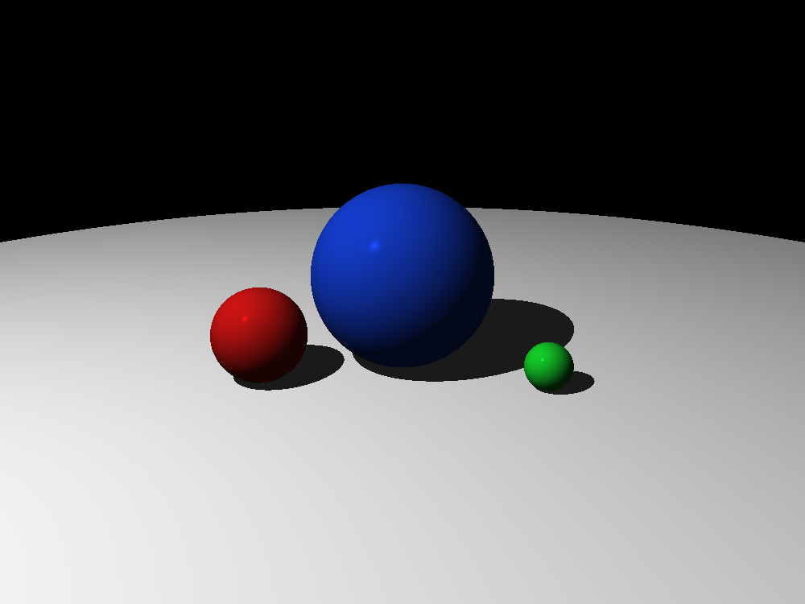
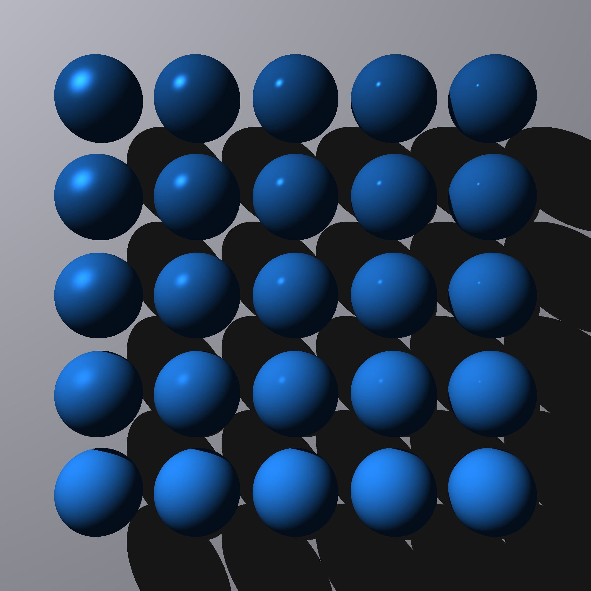
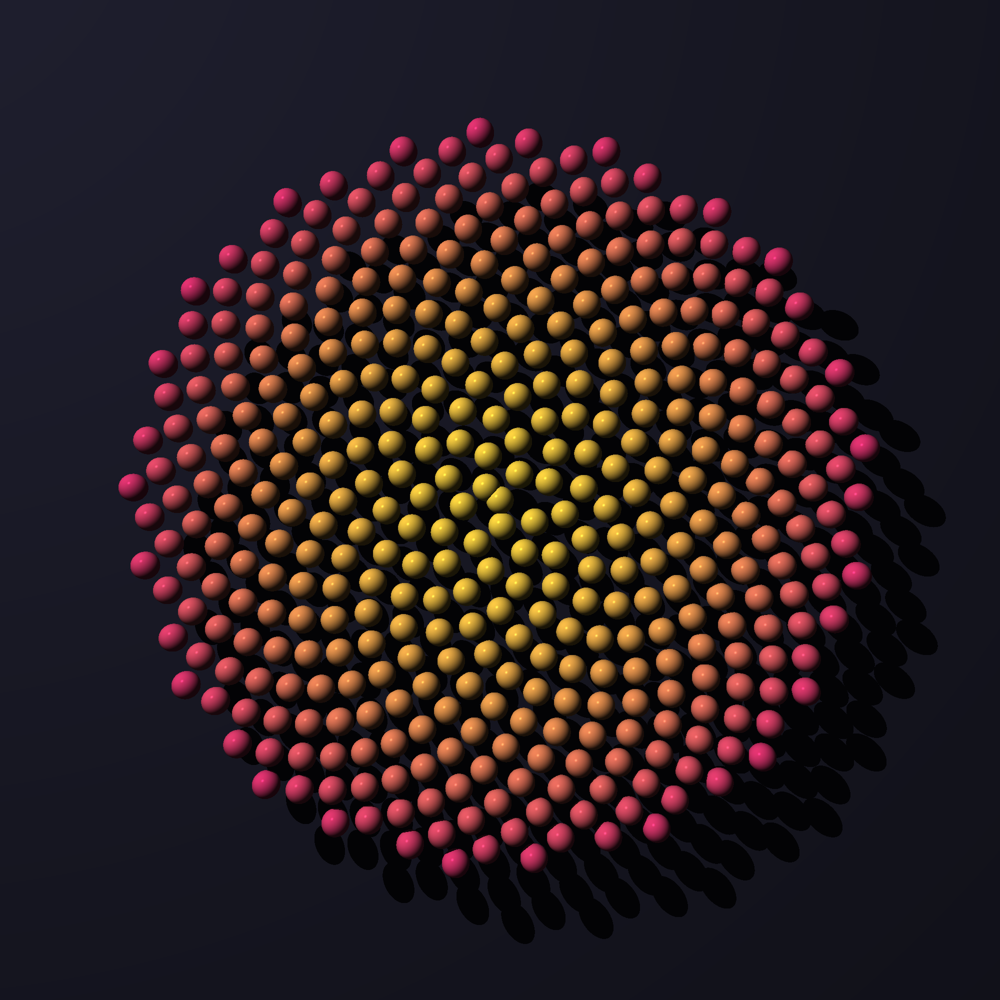
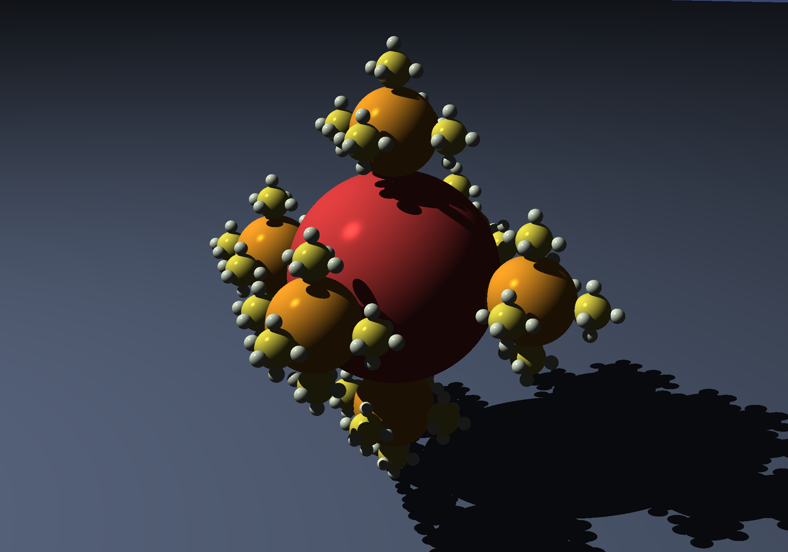
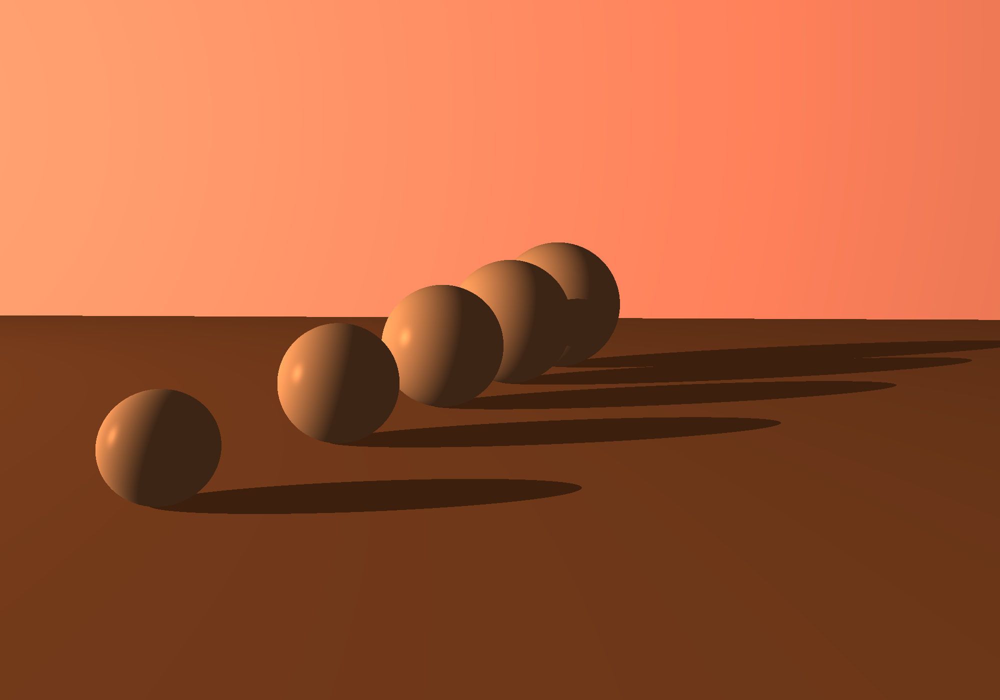

# Ray Tracer

A ray tracer built in C++ from scratch by following [The Ray Tracer Challenge](https://pragprog.com/titles/jbtracer/the-ray-tracer-challenge/). It renders spheres with Phong lighting and shadows from a moveable camera. It's written with no external libraries (GoogleTest is used only for the tests).



> **NOTE:** this is a work in progress. I've done chapters 1–8 of the book, which is until shadows. I added parallel rendering which wasn't originally in the book (or at least in the 8 chapters).

## Some Renders

| | |
| --- | --- |
|  |  |
|  |  |

## Example

Eventually scenes would be described in some markup language but for now it's done in code. This is an example of a scene described in the book:

```cpp
Sphere floor{};
floor.set_transform(transform::scale(10, 0.01, 10));
floor.material.color = Color{ 1,0.9,0.9 };
floor.material.specular = 0;

Sphere left_wall{};
left_wall.set_transform(transform::translate(0, 0, 5) 
						* transform::rotation_y(-std::numbers::pi / 4) 
						* transform::rotation_x(std::numbers::pi / 2) 
						* transform::scale(10, 0.01, 10));
left_wall.material = floor.material;

Sphere right_wall{};
right_wall.set_transform(transform::translate(0, 0, 5)
	* transform::rotation_y(std::numbers::pi / 4)
	* transform::rotation_x(std::numbers::pi / 2)
	* transform::scale(10, 0.01, 10));
right_wall.material = floor.material;

Sphere middle{};
middle.set_transform(transform::translate(0, 1, 0));
middle.material.color = Color{ 0.1, 1, 1 };
middle.material.diffuse = 0.7;
middle.material.specular = 0.3;

Sphere right{};
right.set_transform(transform::translate(1.5, 0.5, -0.5) * transform::scale(0.5, 0.5, 0.5));
right.material.color = Color{ 0, 1, 0 };
right.material.diffuse = 0.7;
right.material.specular = 0.3;

Sphere left{};
left.set_transform(transform::translate(-1.5, 0.33, -0.75) * transform::scale(0.33, 0.33, 0.33));
left.material.color = Color{ 1, 0.2, 0.1 };
left.material.diffuse = 0.7;
left.material.specular = 0.3;

World w{ {floor, left_wall, right_wall, middle, right, left}, {Light{Color{1,1,1}, Tuple{-10,10,-10,1}}} };


Camera c{2000, 1000, std::numbers::pi/3};
c.transform = transform::view_transform(
	Tuple{ 0, 1.5, -5, 1 },
	Tuple{ 0, 1, 0, 1 },
	Tuple{ 0, 1, 0, 0 }
);
``` 

## Testing

The book describes every feature as Cucumber tests. Each scenario for chapters 1–8 has been converted to GTests.

## Credits

This follows [The Ray Tracer Challenge](https://pragprog.com/titles/jbtracer/the-ray-tracer-challenge/) by Jamis Buck. The book gives the specifications and test scenarios and I've implemented it in C++.